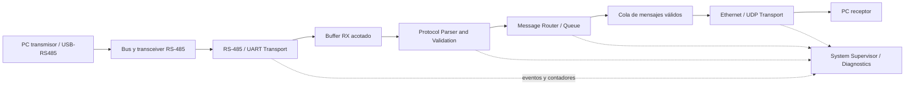

# Arquitectura de firmware de la PoC

Primera especificación para revisión humana, 2026-10-17. La documentación precede
a la implementación. **NOT IMPLEMENTED / NOT VALIDATED:** este documento no aporta
firmware, pruebas ejecutadas ni validación de hardware.

## 1. Decisiones cerradas primero

**DECIDED** identifica acuerdos y requisitos obligatorios. **PROPOSED** identifica
diseño sometido a revisión, sin aprobación implícita de sus parámetros.
**NOT IMPLEMENTED / NOT VALIDATED** identifica ausencia de implementación o
evidencia experimental, incluso para decisiones cerradas. Las secciones 3–8
son PROPOSED salvo requisitos señalados como DECIDED.

**DECIDED:**

- Product Rev. A utiliza STM32H723VET6 con Zephyr. La PoC se orienta a una
  NUCLEO-H723ZG, sujeta a comprobar la placa disponible y sus conexiones.
- Camino físico: PC transmisor → USB-RS485 → bus RS-485 → transceiver RS-485 →
  UART del STM32H723 → Zephyr → Ethernet cableado → PC receptor. Ambos roles
  de PC pueden residir en el mismo equipo.
- RS-485 unidireccional PC → STM32, sin ACK, NACK ni retransmisiones por RS-485.
  El firmware valida los datos antes de remitirlos a Ethernet.
- Detección de errores mediante CRC-16, número de secuencia para diagnóstico
  de discontinuidades y duplicados, y payload máximo de 256 bytes.
- UART no depende de Ethernet; el parser no accede a registros del STM32.
  Recepción y transmisión se desacoplan con almacenamiento acotado. No ejecutar
  operaciones de red bloqueantes en callbacks o interrupciones UART.
- Perder Ethernet no puede bloquear indefinidamente la recepción UART. Con
  recursos finitos y sin retrocontrol RS-485, puede haber descartes.
- **El firmware de la PoC deberá diseñarse para reutilizar los módulos de
  protocolo, enrutamiento, diagnóstico y red en el producto definitivo,
  minimizando dependencias con la placa Nucleo.**

**PROPOSED:** UDP y framing SOF | VERSION | SEQUENCE | LENGTH | PAYLOAD | CRC-16.
No se ha decidido compatibilidad Modbus RTU. RS-485 define el medio eléctrico,
no el protocolo de aplicación.

Fuente principal del baseline: [requisitos locales](industrial_linux_gateway_requirements.md),
complementados por [el alcance PoC](proof_of_concept.md) y los acuerdos anteriores.
No se cambian selecciones de hardware ni se reducen requisitos de Rev. A.

## 2. Plataforma física y alcance

**DECIDED:** la PoC cubre un enlace RS-485 de entrada y Ethernet de salida. CAN-FD,
DI/DO y electrónica industrial final quedan fuera de la demostración. El THVD1420
del producto no determina automáticamente el módulo del banco.

[Zephyr documenta la NUCLEO-H723ZG](https://docs.zephyrproject.org/latest/boards/st/nucleo_h723zg/doc/index.html)
con STM32H723ZG en LQFP144, MAC en el MCU y PHY presente en la placa. Ese PHY
**no debe identificarse como el DP83826I** seleccionado para la PCB del producto.
Verificar modelo/revisión de placa y PHY real antes del montaje; el soporte
documentado no equivale a validación del banco.

Comprobar UART/pines accesibles, niveles lógicos, alimentación del transceiver,
referencia común, polaridad A/B, terminación y polarización del bus; habilitar
recepción y deshabilitar el driver transmisor en el gateway. La consola Zephyr
usa UART3 por defecto en esta placa: evitar que consola/logs compitan con datos.
No se fijan pines ni velocidad serial sin verificar el banco.

## 3. Arquitectura modular y flujo — PROPOSED



| Módulo | Responsabilidad | Límite |
|---|---|---|
| RS-485 / UART Transport | Configurar mediante drivers Zephyr, recibir bloques ordenados, gestionar buffers RX y notificar errores/discontinuidad. | Sin interpretación de tramas, sockets ni destino Ethernet. |
| Protocol Parser and Validation | Consumir bytes incrementalmente, reconocer framing, limitar longitud, verificar versión/CRC y diagnosticar secuencia. | Sin registros, drivers de placa ni operaciones de red; solo emite mensajes válidos. |
| Message Router / Queue | Admitir mensajes válidos, conservar orden de admisión y aplicar descarte por saturación o red ausente. | No verifica CRC ni controla UART. |
| Ethernet / UDP Transport | Gestionar socket, serializar mensajes, intentar envío y publicar estado de red/errores. | No recibe bytes sin validar ni decide validez de protocolo. |
| System Supervisor / Diagnostics | Agregar contadores, derivar estados, coordinar recuperación y exponer snapshots/logs. | No interpreta payload ni espera operaciones de red en callbacks. |

El payload se conserva como bytes opacos. No se inventa normalización semántica:
el procesamiento demuestra framing, validación, diagnóstico y preparación de
salida. Un mensaje inválido termina en diagnóstico/descarte, nunca en la cola.

### Interfaces y propiedad de datos

Contratos conceptuales, no firmas de funciones ni código de aplicación:

| Interfaz | Datos / eventos | Contrato |
|---|---|---|
| UART → parser | Bloque de bytes y longitud; error o discontinuidad RX. | Orden conservado; bloques independientes de límites de trama, con fragmentos o varias tramas por bloque. |
| Parser → router | Versión, secuencia, longitud y payload hasta 256 bytes, tras CRC válido. | Una emisión por candidato válido; rechazo de cabecera/CRC no produce mensaje. |
| Router → red | Copia inmutable del mensaje; resultado de admisión aceptado/descartado. | FIFO finita, inserción sin esperar espacio; sin referencias a memoria temporal del parser. |
| Módulos → supervisor | Contadores y eventos de disponibilidad/error/recuperación. | Actualización segura entre contextos, sin bloquear RX. |
| Supervisor → módulos | Solicitud de recuperación local de recurso recuperable. | Su propietario modifica el recurso; no invalida buffers en uso. |

Se propone copiar mensajes completos de tamaño fijo mediante una cola Zephyr
`k_msgq`: simplifica propiedad con un payload limitado. El parser posee el
candidato hasta copiarlo; red posee su copia extraída hasta enviar o descartar.
Los buffers del driver no se reutilizan hasta terminar el consumo y cumplir
el contrato de liberación de la API UART elegida.

### Concurrencia

Se propone UART asíncrona sujeta al soporte del driver seleccionado. El callback
solo entrega bytes/eventos a almacenamiento preasignado y despierta al consumidor.
Si no se dispone de la API necesaria, se revisa la adaptación del transporte
manteniendo su contrato; no combinar APIs UART incompatibles en el mismo periférico.

Un contexto consumidor ejecuta parser/admisión y otro independiente atiende red:
una espera del stack no debe detener la lectura serial. No se prescribe un hilo
por módulo ni una cantidad total de hilos. Supervisor puede compartir contexto
con trabajo breve diferido; Zephyr ya utiliza contextos propios. El envío no
debe ocupar la cola de trabajo compartida que atienda RX o recuperación UART.

Usar envíos no bloqueantes o con espera finita configurable. Justificar
prioridades, stacks y presupuestos mediante tasa serial, ráfagas y latencia
de servicio, sin cantidades arbitrarias. Referencias: [API UART](https://docs.zephyrproject.org/latest/hardware/peripherals/uart.html)
y [colas de mensajes](https://docs.zephyrproject.org/latest/kernel/services/data_passing/message_queues.html).

## 4. Framing y validación — PROPOSED

### Referencia Adalight examinada

Se revisaron los tres archivos del proyecto de experiencia previa:

- [CMSIS: APP/adalight.c](https://github.com/anhenaobe/STM32-Ambilight-Driver-Zephyr-CMSIS-/blob/main/stm32_ambilight/cmsis_platformio/src/APP/adalight.c).
- [Zephyr: app/adalight.c](https://github.com/anhenaobe/STM32-Ambilight-Driver-Zephyr-CMSIS-/blob/main/stm32_ambilight/zephyr_platformio/src/app/adalight.c).
- [Host: protocol.py](https://github.com/anhenaobe/STM32-Ambilight-Driver-Zephyr-CMSIS-/blob/main/stm32_ambilight/host/adalight_stable_rgbw/protocol.py).

Ambos parsers buscan Ada, leen dos bytes de cantidad de LEDs menos uno y verifican
un checksum XOR de cabecera. Solo aceptan la cantidad configurada y reciben los
bytes de color correspondientes; el checksum no cubre ese payload. El host
construye esa cabecera y escribe la trama completa. La pausa al abrir el puerto
no delimita tramas. Se aprovecha el patrón incremental con inicio y longitud,
sin trasladar el formato de LEDs ni su checksum al gateway.

### Propuesta breve para revisión

```text
SOF | VERSION | SEQUENCE | LENGTH | PAYLOAD | CRC-16
```

SOF identifica un inicio candidato; VERSION selecciona el formato; SEQUENCE aporta
diagnóstico; LENGTH expresa bytes de payload y debe representar 256 sin truncar.
Se propone CRC-16 desde VERSION hasta el final de PAYLOAD, incluyendo secuencia
y longitud. Requieren aprobación el valor/tamaño de SOF, anchos de campos,
endianness, variante CRC completa (polinomio, inicialización, reflexión, XOR final
y orden de bytes) y timeouts. Tampoco se decide si se acepta payload vacío.
No se heredan valores de Adalight.

La longitud permite consumir una trama y buscar la siguiente en el byte inmediato,
sin retardos artificiales entre escrituras. Frente a delimitar solo por silencio,
evita depender del jitter del PC, USB y planificación para reconocer fronteras.
El timeout abandona un candidato incompleto; no es delimitador principal. Operar
sin pausas no implica sostener cualquier tasa de entrada sin saturación.

El parser recorre búsqueda de SOF → cabecera → payload → CRC:

- Antes de escribir payload, validar versión y LENGTH contra 256 y capacidad
  real del buffer. Rechazar tamaños fuera de rango y cálculos con desbordamiento;
  nunca reservar memoria según una longitud no validada.
- Con CRC correcto, emitir el mensaje y continuar con los bytes pendientes del
  mismo bloque. En recepción normal, SOF dentro del payload es dato.
- CRC incorrecto: descartar candidato y contar CRC inválido. Versión/longitud
  no admitida: descartar como malformada.
- Candidato sin terminar al expirar el límite configurable, o interrumpido por
  error UART: abandonar como incompleto. El silencio sin candidato abierto
  no es una trama incompleta.
- Tras cabecera o CRC inválidos, buscar el siguiente SOF desde el byte posterior
  al inicio rechazado, reconsiderando bytes ya almacenados con memoria y trabajo
  acotados. Conservar coincidencias parciales del marcador entre bloques. Cada
  candidato nuevo debe superar cabecera, longitud y CRC; encontrar SOF no basta.
- Tras timeout, aplicar esa búsqueda a bytes disponibles; tras overflow o pérdida
  conocida de continuidad, invalidar el candidato afectado y buscar en el flujo
  íntegro disponible. Una longitud corrupta puede consumir bytes de tramas
  siguientes, y el payload puede contener falsos SOF: no se garantiza recuperar
  la siguiente trama inmediata ni resincronización infalible.

CRC reduce la aceptación de corrupción accidental, pero tiene colisiones,
no confirma recepción por el PC y no autentica al emisor. No garantiza entrega
ni protección frente a manipulación intencional.

### Secuencia diagnóstica

Se propone tomar referencia de la primera trama válida y comparar solo tramas
con CRC válido, antes de admisión en cola. Repetir el último número cuenta como
duplicado inmediato; otro valor distinto del siguiente esperado cuenta como
discontinuidad, sin inferir su causa. Se propone reenviar duplicados válidos
para conservar evidencia en el PC.

Cerrar ancho, incremento modular y tratamiento de reinicio del emisor junto al
formato. No se detectan todos los duplicados históricos ni se distingue pérdida,
reinicio o reordenamiento solo por secuencia. Recuperar Ethernet no reinicia la
referencia serial; reiniciar explícitamente parser/sesión debe registrarse y
establecer nueva referencia.

## 5. Ethernet y fiabilidad — PROPOSED

Se propone UDP por la sencillez de enviar mensajes discretos a un PC. Cada trama
válida admitida originaría un datagrama con versión, secuencia, longitud y payload
sin transformación semántica. Cerrar su codificación binaria junto al protocolo
del host; conservar secuencia para comparar registros de origen y destino.

Red disponible significa enlace físico activo, configuración IP válida y socket
listo; no demuestra que el PC esté escuchando. IP local, método de configuración,
destino y puerto serán configurables. Dimensionar la serialización frente al
MTU efectivo para evitar fragmentación en el banco previsto.

UDP puede perder, duplicar o reordenar datagramas; no garantiza entrega ni orden.
Un envío aceptado por el stack solo es éxito local. La propuesta no añade ACK
ni reintentos de aplicación UDP. La pérdida silenciosa posterior al envío
requiere registros adicionales del PC para observarse.

## 6. Buffers, saturación y recuperación — PROPOSED

Preasignar buffer RX, candidato, cola de mensajes y buffer de serialización.
Documentar capacidades antes de implementar, incluyendo cabeceras, CRC y
metadatos, no solo los 256 bytes de payload.

Dimensionar RX con los bytes recibidos durante el máximo intervalo de servicio
más margen de ráfaga; dimensionar la cola con tasa de mensajes y demora máxima
de servicio de red. No se almacena una interrupción de duración ilimitada.
El presupuesto incluye stacks y buffers internos de Zephyr/red y debe caber
en el VET6, no depender de la mayor flash de la Nucleo.

Política propuesta, con descarte contabilizado:

- Cola llena: descartar el mensaje nuevo sin esperar espacio; conservar admitidos
  en FIFO. Contar saturación y mensaje descartado.
- Red no disponible: continuar RX, parser y diagnóstico; descartar nuevos mensajes
  válidos para salida y vaciar pendientes con causa registrada. No acumular datos
  obsoletos para el retorno del enlace.
- Fallo de envío: contar error y descartar el mensaje, sin reencolar indefinidamente.
  Si cambió disponibilidad, aplicar la política anterior.
- RX lleno: contar bytes descartados/overflow, notificar discontinuidad e invalidar
  el candidato que atraviese la pérdida. Sin ACK no se puede solicitar repetición.
- Retorno del enlace: restablecer IP/socket si hace falta y admitir nuevos mensajes
  cuando la salida esté lista. Una desconexión durante envío puede producir fallo
  local; no demuestra por sí sola que el receptor no recibió el datagrama.

Los recursos tienen propietarios definidos. CRC incorrecto o cable desconectado
no requieren reiniciar todo el sistema.

## 7. Estados operativos — PROPOSED

Estados conceptuales del supervisor, diferentes del parser y sin exigir otro
hilo. Agregan salud de módulos; una condición de red no detiene por sí sola RX.

| Estado | Entrada / acciones | Salida / transición |
|---|---|---|
| INITIALIZATION | Preparar configuración, contadores, buffers y dispositivos; habilitar RX al estar listos sus recursos. | Recursos listos → NETWORK_WAIT o, con red lista, OPERATIONAL. Fallo recuperable concreto → ERROR_RECOVERY; configuración/hardware inutilizable sin recuperación definida → DEGRADED con causa persistente. |
| NETWORK_WAIT | Arranque sin red disponible; mantener RX/validación si funcionan y descartar salida por falta de red. | Enlace, IP y socket listos → OPERATIONAL. Fallo adicional → DEGRADED o ERROR_RECOVERY si hay acción recuperable definida. |
| OPERATIONAL | RX/validación y salida disponibles; admisión normal. | Pérdida de enlace/IP, saturación o fallo de módulo → DEGRADED; recurso que requiere recuperación local concreta → ERROR_RECOVERY. |
| DEGRADED | Registrar causas, mantener módulos sanos y descartes controlados. CRC aislado suma diagnóstico sin forzar este estado. | Causas despejadas y servicio listo → OPERATIONAL; acción recuperable concreta → ERROR_RECOVERY. Sin acción válida permanece DEGRADED. |
| ERROR_RECOVERY | Solo ante recurso recuperable: p. ej., RX detenido que puede rearmarse o socket inválido que puede recrearse. Intentos limitados y espera finita configurable, sin bloquear módulos independientes. | Recuperado → OPERATIONAL si todo listo, NETWORK_WAIT si nunca se obtuvo red o DEGRADED si persisten causas. Agotar intentos → DEGRADED con fallo registrado. |

Desconectar Ethernet desde OPERATIONAL entra en DEGRADED; no exige ERROR_RECOVERY
ni ciclos de reinicio. Sus eventos activan la recuperación normal del enlace.
Salir de DEGRADED por saturación cuando cese la condición y vuelva la capacidad
de servicio. No se fijan timeouts numéricos.

## 8. Diagnóstico — PROPOSED

Contadores acumulativos por arranque, snapshots coherentes y logs limitados en
frecuencia, separados de la UART de datos. Documentar ancho y desbordamiento
al definir la interfaz; consultar no debe borrarlos implícitamente.

| Contador | Observación |
|---|---|
| Bytes recibidos UART | Bytes entregados por el driver, no bytes nunca capturados por hardware. |
| Tramas válidas | Aceptadas tras cabecera/CRC, aunque luego se descarten por red o cola. |
| CRC inválido | Candidatos completos con CRC incorrecto. |
| Malformadas | Cabecera, versión o longitud no admitida. |
| Incompletas | Candidatos abandonados por timeout o interrupción antes de completarse. |
| Discontinuidades de secuencia | Saltos observados entre tramas válidas según regla aprobada. |
| Duplicados detectados | Repetición del último número válido según ventana propuesta. |
| Saturación de colas | Admisiones fallidas por cola llena; separado de red ausente. |
| Errores de transmisión Ethernet | Fallos locales reportados al enviar, no todas las pérdidas UDP. |
| Pérdida y recuperación de enlace | Transiciones físicas down/up; arranque desconectado no es pérdida de enlace previo. |

Añadir bytes descartados RX, errores UART, mensajes descartados por causa e
intentos/envíos UDP aceptados localmente para reconciliar el flujo. No contar
un mismo candidato abandonado como malformado, incompleto y CRC inválido a la vez.
Secuencia es un diagnóstico independiente de la validez de la trama. Registrar
el estado IP/socket separado del enlace físico.

No es una medición completa de paquetes perdidos: faltan bytes nunca observados,
pérdidas tras éxito local UDP y ambigüedades de secuencia. Comparar logs en los
PC mejora observación, sin garantizar entrega ni una medición universal de pérdida.

## 9. Reutilización en Product Rev. A

**DECIDED:** aplicar el requisito de §1 con C y APIs Zephyr, separación de lógica
y drivers, interfaces documentadas, parámetros configurables y buffers gestionados
y dimensionados explícitamente. DeviceTree describe instancias, pinctrl y conexiones
cuando corresponda; Kconfig configura capacidades y opciones de software. No
dispersar pines Nucleo, identidades de PHY o registros en parser/router.

**PROPOSED:** reutilizar parser/CRC, mensajes, políticas de cola, diagnóstico y
UDP cambiando configuración de placa/adaptaciones de driver. Probar parser/CRC
con bytes en host o entorno Zephyr sin hardware físico. Serializar sin depender
del layout de estructuras C. Si se utiliza DMA, su adaptación deberá respetar
memoria accesible, vida útil y coherencia de caché sin exponerlas al protocolo.

Migrar STM32H723ZG → STM32H723VET6 exige revisar pines, flash, memoria utilizable
por drivers y soporte/configuración DP83826I; no basta cambiar el nombre de placa.
**NOT IMPLEMENTED / NOT VALIDATED:** portabilidad, recursos, tasa sostenida y
funcionamiento en Rev. A no han sido validados.

## 10. Justificación STM32H723 frente a ESP32-C6

**DECIDED:** mantener STM32H723VET6 + Zephyr. La comparación explica el baseline,
sin seleccionar hardware alternativo. Fuentes oficiales:
[ST DS13313 Rev. 5](https://www.st.com/resource/en/datasheet/stm32h723ve.pdf),
§2 tabla 1, §3.42–3.44 y §8;
[ESP32-C6 datasheet v1.5](https://documentation.espressif.com/esp32-c6_datasheet_en.html),
§4.1.1–4.1.2 y §4.2.1; y
[configuración oficial ESP-IDF para C6](https://docs.espressif.com/projects/esp-idf/en/v5.3.3/esp32c6/api-reference/kconfig.html#config-esp32c6-universal-mac-addresses).

| Aspecto | STM32H723VET6 | ESP32-C6 | Relación con Rev. A |
|---|---|---|---|
| Ethernet | MAC 10/100 integrado, DMA y RMII; requiere PHY externo. | Sin MAC Ethernet integrado; necesita controlador Ethernet externo, por ejemplo SPI, además de función PHY. | H723 conecta al DP83826I previsto; un PHY solo no proporciona al C6 el MAC ausente. |
| CAN | FDCAN integrado. | TWAI CAN 2.0 clásico, no CAN-FD. | H723 cubre CAN-FD con ATA6561; C6 necesitaría controlador CAN-FD externo para ese requisito. |
| Procesamiento/memoria | Cortex-M7 hasta 550 MHz, FPU/DSP y DMA; VET6: 512 KB flash y 564 KB SRAM total. | RISC-V HP hasta 160 MHz y núcleo LP; 512 KB HP SRAM y 16 KB LP SRAM. | Dimensionar concurrencia/buffers: memoria del silicio no equivale a memoria libre o throughput validado. |
| Periféricos | UART/USART y GPIO junto a Ethernet/FDCAN. | UART, SPI y GPIO; radios Wi-Fi 6, BLE y 802.15.4. | Rev. A exige dos RS-485, CAN-FD, Ethernet y DI/DO: verificar pines simultáneos por encapsulado. Radios no sustituyen Ethernet cableado. |

Como inferencia de integración, reunir MAC y FDCAN en H723 evita controladores
externos y sus buses/drivers para esos requisitos. No demuestra menor precio
total ni justifica la selección solo por frecuencia. ESP32-C6 puede implementar
esta PoC con controlador Ethernet y transceiver RS-485 externos; la integración
adicional cobra más relevancia al cubrir todas las interfaces del producto.

## 11. Estrategia futura de verificación

**PROPOSED — pruebas planificadas, ninguna ejecutada en esta tarea.** No se
aportan resultados experimentales.

| Paso | Prueba futura | Evidencia / criterio |
|---|---|---|
| 1 | Recepción UART directa a niveles compatibles. | Comparar bytes/patrones, fragmentación entre callbacks, ráfagas y separación de consola. |
| 2 | USB-RS485, bus y transceiver. | Repetir patrones, registrar conexiones/configuración y acreditar camino físico de entrada. |
| 3 | Unitarias parser/CRC sin placa. | Vectores independientes al cerrar CRC; payload máximo, longitudes inválidas, SOF en payload, cualquier fragmentación y tramas consecutivas sin pausas. Solo candidatos válidos emitidos y sin accesos fuera de buffer. |
| 4 | UDP independiente de UART. | Mensajes de prueba en PC y captura/log de secuencia/payload; distinguir envío local de recepción real. |
| 5 | Integración RS-485 → UDP. | Comparar origen, validez/admisión y destino; contenido y orden observado bajo carga declarada. |
| 6 | Tramas corruptas e incompletas. | Alterar cabecera/payload/CRC, truncar, introducir ruido/falsos SOF: sin reenvío inválido, causas contabilizadas y recuperación con tramas válidas posteriores. |
| 7 | Secuencias discontinuas y duplicados. | Saltos, repeticiones, wrap y reinicio según contrato aprobado; verificar contadores y reenvío propuesto sin afirmar pérdida total. |
| 8 | Saturación de buffers/colas. | Forzar exceso RX y red lenta: memoria acotada, descarte definido, diagnóstico y retorno al flujo válido. |
| 9 | Desconexión/recuperación Ethernet. | Retirar/restaurar cable, comprobar IP/socket: UART sigue consumiéndose, descartes explicables, estados coherentes y nuevos envíos al recuperar disponibilidad. |
| 10 | Demostración y registro. | Guardar revisión firmware/Zephyr, configuración, placa, conexiones, parámetros, carga/duración, logs/captura y resultado por criterio con limitaciones observadas. |

Separar tramas válidas, descartes, intentos de envío y recepciones en PC. Cerrar
tasa y límites de aceptación antes de medir; no se declara tasa máxima ni
latencia ya validada.

## 12. Cierre necesario antes de implementar

Solo requieren cierre técnico inmediato:

1. Confirmar placa/banco, transceiver, conexiones UART/Ethernet reales y
   configuración serial; fijar versión Zephyr para implementar.
2. Aprobar framing/host: campos y anchos, SOF, endianness, variante y cobertura
   CRC, secuencia/reinicio y límite para abandonar trama incompleta.
3. Aprobar UDP, representación de datagrama y configuración IP/destino/puerto.
4. Aprobar descarte/recuperación y dimensionar buffers/cola con carga y criterios
   de ensayo previstos.

No se identifican contradicciones que exijan modificar el documento maestro:
el half-duplex de Rev. A admite el uso unidireccional reducido de la PoC. Las
diferencias de memoria, placa y PHY requieren comprobación, no cambio de selección.
Se detiene el trabajo documental para revisión humana antes de implementar.
