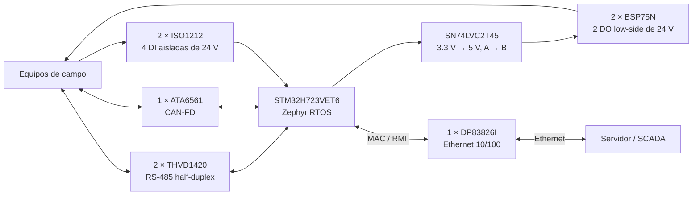
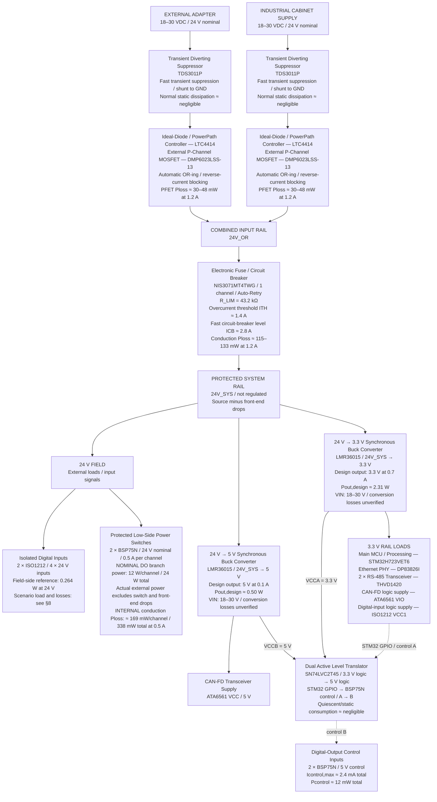

# Industrial Communication Gateway

## 1. Overview

El Industrial Communication Gateway conecta equipos industriales con una red IP
para adquirir, procesar y comunicar datos hacia un servidor o sistema SCADA.
Integra RS-485, CAN-FD y señales digitales de 24 V en una arquitectura embebida
basada en STM32H723VET6 y Zephyr RTOS.

En instalaciones industriales conviven equipos con interfaces eléctricas y
formatos de datos diferentes. El gateway proporciona una plataforma común entre
esas interfaces de campo y Ethernet, con procesamiento local para interpretar y
normalizar la información.

La electrónica de campo se organiza en bloques de comunicación y E/S separados
funcionalmente del procesamiento. El documento describe la arquitectura, los
componentes seleccionados y los cálculos eléctricos del diseño actual.

## 2. System Architecture

El flujo principal de información es:

```text
FIELD DEVICES
      ↓
INDUSTRIAL INTERFACES
      ↓
STM32H723VET6 + ZEPHYR RTOS
      ↓
ETHERNET
      ↓
SERVER / SCADA
```

### 2.1 Conexión de bloques



El diagrama muestra relaciones funcionales entre bloques. Las flechas de E/S
representan adquisición o control, no conexiones eléctricas pin a pin.

### 2.2 Dominios eléctricos

| Dominio | Uso en la arquitectura |
|---|---|
| 3.3 V | MCU, DP83826I, THVD1420, VIO del ATA6561, VCC1 de los ISO1212 y VCCA del SN74LVC2T45 |
| 5 V | VCC del ATA6561, VCCB del SN74LVC2T45 y control de los BSP75N |
| 24 V | Entrada nominal del gateway, señales digitales de campo y cargas externas de las DO |

Las entradas ISO1212 incorporan aislamiento entre las señales de campo y el lado
lógico. Las cargas de las DO pertenecen al dominio de campo de 24 V.

## 3. Processing Platform

El microcontrolador principal es **STM32H723VET6**, en encapsulado LQFP100.
La plataforma de software es **Zephyr RTOS**.

El STM32 reúne procesamiento, MAC Ethernet, FDCAN y periféricos UART/USART en un
solo dispositivo. Esta integración se ajusta al conjunto de interfaces del
proyecto y permite construir una PCB propia alrededor de un MCU principal.
El encapsulado LQFP100 facilita el montaje y la inspección de esa placa.

Zephyr proporciona la base de ejecución del firmware embebido. La función del
software es adquirir datos desde los periféricos, interpretar la información de
campo, normalizarla y entregarla al servicio de comunicación por Ethernet.

El MAC Ethernet y FDCAN pertenecen al MCU. DP83826I y ATA6561 implementan las
respectivas interfaces físicas con el exterior.

## 4. Communication Interfaces

### 4.1 Ethernet

Se utiliza **1 × DP83826I** como PHY externo para el MAC Ethernet del STM32H723.
La conexión entre MAC y PHY utiliza **RMII**.

- Ethernet **10BASE-Te / 100BASE-TX**.
- Alimentación analógica VDDA3V3 y lógica VDDIO de **3.3 V**.
- Dispositivo orientado a aplicaciones industriales.
- El PHY implementa la capa física; el MAC está integrado en el STM32.

El modo principal utilizado en el cálculo de consumo es 100BASE-TX con RMII,
100% de tráfico y la configuración RMII leader para VDDIO.

```text
STM32H723 Ethernet MAC ↔ RMII ↔ DP83826I ↔ Ethernet
```

### 4.2 RS-485

Se utilizan **2 × THVD1420** para dos interfaces físicas RS-485 independientes.
Cada transceiver conecta un periférico UART/USART con su bus de campo.

- Configuración **half-duplex**.
- Alimentación de **3.3 V**.
- Capacidad del componente de hasta **12 Mbps**.
- Recepción fail-safe y carga de bus compatible con hasta **256 nodos**.
- Protección integrada ESD/EFT y rango industrial de temperatura.

La capacidad de 12 Mbps corresponde al componente. La asignación de corriente
adoptada para el diseño es **50 mA por transceiver**, descrita en §8.3.

### 4.3 CAN-FD

Se utiliza **1 × ATA6561** como transceiver físico para el controlador FDCAN del
STM32H723.

```text
STM32H723 FDCAN ↔ ATA6561 ↔ CANH / CANL
```

- Soporte **CAN-FD**, con capacidad de comunicación de hasta aproximadamente
  **5 Mbps** según datasheet.
- **VCC = 5 V** para el transceiver de bus.
- **VIO = 3.3 V** para la interfaz lógica con el STM32.
- Protecciones integradas de bus y función de dominant time-out.

La alimentación VIO permite utilizar niveles lógicos de 3.3 V manteniendo VCC
a 5 V. Ambos consumos se contabilizan en sus respectivos rails.

## 5. Industrial Digital I/O

### 5.1 Digital Inputs

Se utilizan **2 × ISO1212**, con dos canales por dispositivo, para un total de
**4 entradas digitales industriales aisladas de 24 V**.

- Aislamiento integrado entre campo y lógica.
- Compatibilidad del receptor con **IEC 61131-2 Type 1, 2 y 3**.
- Lado lógico alimentado mediante **VCC1 = 3.3 V**.
- Salidas lógicas compatibles con el dominio de 3.3 V del MCU.
- El receptor obtiene la energía del lado de campo desde la propia señal de
  entrada, sin una alimentación de campo independiente para el IC.

El consumo de VCC1 y la corriente tomada de cada señal de campo se registran
por separado en el Power Budget.

### 5.2 Digital Outputs

Se utilizan **2 × BSP75N** para dos salidas digitales industriales **LOW-SIDE**.

| Parámetro de canal | Valor |
|---|---:|
| Tensión nominal de campo | 24 V |
| Corriente nominal de carga | 500 mA |
| Canales | 2 |
| VDS continuo del componente | 60 V |

En una salida low-side, la carga se conecta al positivo de campo y el switch
controla su retorno. Esta topología define el tipo de salida del gateway.

BSP75N es un dispositivo autoprotegido para aplicaciones de 12 V y 24 V con
cargas resistivas, inductivas y capacitivas. Integra protección contra
cortocircuito, sobrecorriente y sobretemperatura, además de active clamp y
protección frente a load dump.

Las características de control y RDS(on) utilizadas en §8 se evalúan a
**VIN = 5 V**. El datasheet especifica 4.5 V como tensión mínima de entrada para
la protección de sobretemperatura; la nota 8 indica que las protecciones pueden
operar fuera de especificación por debajo de ese nivel.

### 5.3 Control de las DO

**1 × SN74LVC2T45** implementa traducción activa y buffer de dos señales de
control del STM32 hacia los dos BSP75N. **VCCA = 3.3 V**, **VCCB = 5 V** y
la dirección es fija **A → B**. DIR se conecta a VCCA para mantenerlo alto,
según la tabla funcional del fabricante [D11].

La corriente de entrada de los BSP75N procede del rail de 5 V a través de las
salidas B del traductor. Se contabiliza una sola vez en el presupuesto. Las
entradas CMOS deben mantenerse en niveles definidos; se utilizan desacoplos
próximos a ambas alimentaciones del traductor.

## 6. Power Architecture

### 6.1 Entrada y Power Tree

La alimentación nominal es **24 VDC**, con objetivo de operación continua de
**18–30 VDC**. Hay dos entradas físicas: adaptador externo y alimentación de
un gabinete industrial. Ambas pueden conectarse simultáneamente. No existe
prioridad explícita: dos ramas ideal-diode OR-ing convergen en **24V_OR**, y
un canal del eFuse genera **24V_SYS**.

La potencia fluye desde una **fuente externa de 18–30 V** hacia la protección
de transitorios, el OR-ing ideal-diode y el eFuse. Desde **24V_SYS** se distribuye
a las cargas de campo de 24 V y a los bucks de 3.3 V y 5 V. La protección de
entrada consume muy poca potencia en operación normal; las pérdidas de
conversión se concentran en los bucks. Las dos ramas DO gestionan **24 W
nominales a 24 V / 1 A**; la potencia efectiva entregada a las cargas se reduce
por las caídas del front-end y de los interruptores (§8). 24V_SYS sigue a la
fuente menos esas caídas, sin regulación a 24 V exactos.



El TDS es una protección en derivación entre la línea y GND, no un elemento
serie. Las DI toman corriente de sus señales de campo; su aporte al consumo de
24V_SYS depende de si esas señales se alimentan desde el propio gateway.
Las cargas de las DO se alimentan desde el positivo de campo y los BSP75N
conmutan su retorno.


En el diagrama, **Pload** identifica la potencia tomada por una carga,
**Ploss** identifica pérdidas y **Pout,design** la capacidad utilizada para
dimensionar un regulador. Las corrientes de diseño de los bucks no representan
el consumo real del gateway. La disipación estática de la protección se separa
de la energía absorbida durante un surge. Los valores de conducción indicados
usan las referencias de resistencia a 25 °C; los ≈169 mW por BSP75N corresponden
al máximo de resistencia de esa condición, no a todo el rango térmico.
El detalle de consumos y condiciones permanece en el Power Budget (§8).

### 6.2 Ideal-diode OR-ing

Se utilizan **2 × LTC4414** y **2 × DMP6023LSS-13**, uno de cada tipo por entrada.
El PFET es P-channel de **60 V**, **VGS máximo ±20 V** y encapsulado **SO-8
convencional**, sin pad inferior expuesto ni via-in-pad obligatorio [D7].

En cada rama, el drain del PFET se conecta a la entrada individual y el source
a 24V_OR, orientando el diodo de cuerpo desde la entrada al bus. VIN y SENSE del
LTC4414 se conectan a esos nodos mediante rutas Kelvin. CTL se mantiene bajo
para permitir el funcionamiento automático [D6].

El LTC4414 opera hasta **36 V** y sus pines VIN/SENSE admiten **40 V absolutos**.
Su gate clamp es de **8–9 V**. El PFET especifica **33 mΩ máximo a VGS = −4.5 V,
ID = −4 A y TA = 25 °C**; ese valor se utiliza como referencia conservadora de
conducción con el gate drive disponible. No se traslada la especificación de
−10 V al drive real ni se considera 33 mΩ un máximo para toda la temperatura.

El controlador intenta regular aproximadamente **20 mV**. A 1.2/1.5 A eso
requiere 16.7/13.3 mΩ respectivamente; una caída mayor es admisible en este
diseño. Con 33 mΩ, **Vdrop = I × R** y **Ploss = I² × R** producen:

| Corriente de rama | Vdrop calculado | Ploss calculada |
|---:|---:|---:|
| 1.2 A | 39.6 mV | 47.5 mW |
| 1.5 A | 49.5 mV | 74.3 mW |

La fuente de mayor tensión tiende a suministrar la carga. Fuentes muy próximas
pueden contribuir ambas, sin reparto de corriente preciso garantizado. El
controlador bloquea corriente inversa con su respuesta dinámica; los retardos
de conmutación y las fugas no equivalen a corriente inversa instantánea nula.

### 6.3 Supresión de transitorios externos

Se utilizan **2 × TDS3011P de Semtech**, uno físicamente próximo a cada entrada,
entre línea y GND, antes del LTC4414. El dispositivo utiliza un shunt FET
interno y presenta resistencia dinámica típica de **7.4 mΩ**, medida entre
1 A y 35 A con pulso 8/20 µs [D8].

| Parámetro | Valor y condición del datasheet |
|---|---|
| VRWM | 30 V |
| VBR | 34–39 V, IT = 1 mA |
| VC | 38 V típico / 40 V máximo, IPP = 35 A |
| Pulso de clamp | Combinado 1.2/50 µs de tensión y 8/20 µs de corriente, RS = 2 Ω |
| IPP | 35 A, 8/20 µs |
| PPK | 1400 W, 8/20 µs |
| Fuga a 30 V | 0.05 µA típica / 1 µA máxima, T = 25 °C |

**Trade-off aceptado:** el clamp máximo especificado de **40 V coincide con el
absolute maximum del LTC4414**. La selección sirve para transitorios rápidos
bajo las condiciones citadas; **no existe margen garantizado por debajo de
40 V**, ni constituye protección frente a sobretensión continua.

El layout debe minimizar el lazo conector–TDS–GND, con conexiones cortas y
múltiples vías al plano GND. La tensión adicional de las interconexiones puede
estimarse mediante **V = L × di/dt**; el clamp del componente no elimina ese
overshoot.

### 6.4 eFuse de 24V_SYS

Se utiliza **NIS3071MT4TWG de onsemi**, variante **MT4 Auto-Retry**, con **un
solo canal** en la rama principal. Integra protección de sobrecorriente,
circuit breaker, soft-start/inrush control, protección térmica y control
mediante EN. Para canales no utilizados, **INx y ENx se conectan a GND**;
OUTx queda sin carga [D9].

Se adopta **R_LIM = 43.2 kΩ, E96**, entre ILIM y GND. La figura 5 del datasheet,
aplicable a **MT3/MT4**, permite estimar **ITH ≈ 1.4 A** y, con la relación
**ICB = 2 × ITH**, **ICB ≈ 2.8 A**. Son lecturas aproximadas de la curva,
no umbrales exactos ni límites garantizados para esa resistencia.

La referencia previa utilizada para dimensionar esta protección es **≈1.18 A**;
no es el consumo recalculado ni un máximo garantizado del gateway. El balance de §8 mantiene la corriente del canal en función de las pérdidas
de los dos bucks. Respecto a la referencia de 1.18 A, el umbral conserva
0.22 A de margen nominal; el margen frente al consumo vigente requiere cerrar
las pérdidas de conversión y no queda validado por esa referencia.
Los cálculos térmicos a 1.5 A representan un punto de evaluación del camino de
potencia: una carga sostenida de ese nivel puede activar la protección con el
ajuste elegido. El eFuse es un circuit breaker con temporizador de sobrecorriente,
no una fuente regulada a ITH.

El datasheet especifica **80 mΩ típico / 92 mΩ máximo por canal a TJ = 25 °C**
y **135 mΩ típico / 155 mΩ máximo a TJ = 150 °C**. El rango de tensión de
entrada es hasta 60 V steady-state, con 65 V transitorios de duración ≤100 µs.

### 6.5 Consideraciones de layout de alimentación

NIS3071, desacoplos y nodos asociados deben mantenerse próximos, con conexiones
cortas y capacitancia local según las recomendaciones del fabricante. En una
PCB compacta se utilizan recorridos internos del orden de pocos centímetros;
la longitud por sí sola no determina la amplitud del transitorio al abrir.

El análisis físico utiliza **V = L × di/dt** y **E = 0.5 × L × I²**, sin asignar
una inductancia antes de conocer el trazado. El datasheet advierte de picos
positivos en IN y negativos en OUT. Una Schottky de GND hacia VOUT, con ánodo
en GND, se evalúa si el análisis del layout final exige limitar los picos
negativos; este criterio no añade un componente al Power Tree.

La propuesta común de los bucks conmuta nominalmente a 1 MHz, con armónicos. La evaluación de filtrado diferencial LC/pi
puede comenzar con una frecuencia de corte conceptual de **20–50 kHz**. Se
verifican atenuación, corriente, saturación, DCR, pérdidas I²R, damping,
impedancia de entrada y estabilidad antes de materializar el filtro. Este
criterio de layout no define L/C ni implica cumplimiento de una norma EMC.

### 6.6 Conversión de potencia

Dos **LMR36015**, convertidores buck síncronos independientes, generan los rieles
desde **24V_SYS, 18–30 VDC** [D12]. La familia queda cerrada para ambos rieles.

| Riel | Corriente de diseño | Potencia de salida de diseño | Carga presupuestada (§8) |
|---|---:|---:|---:|
| 3.3 V | 0.7 A | 2.31 W | 534.303 mA / 1.7631999 W |
| 5 V | 0.1 A | 0.50 W | 72.403 mA / 0.362015 W |

**Propuesta concreta de MPN común: 2 × LMR36015FBRNXR**, salida ajustable,
encapsulado RNX VQFN-HR de 12 pines, PWM forzado (**FPWM**) y frecuencia nominal
**1 MHz**. La tabla de variantes de [D12], p. 3, y §9.4.2, p. 16, identifican
esa combinación. La tabla 10-1, p. 19, contempla 3.3 V y 5 V a 1 MHz; la tabla
10-5, p. 30, emplea explícitamente LMR36015FBRNXR en 5 V. El rango de entrada
recomendado es 4.2–60 V y la capacidad del IC es 1.5 A (§8.3); las capacidades
de diseño de esta aplicación permanecen en 0.7 A y 0.1 A.

Como comprobación de relación de conversión, a 30 V y 1 MHz los tiempos ON
ideales son 110 ns (3.3 V) y 167 ns (5 V). Incluso a 1.15 MHz, extremo del
oscilador, son aproximadamente 96 ns y 145 ns, superiores a los 83 ns del
límite especificado de tiempo ON mínimo [D12, §8.5–8.6, p. 7]. El tiempo OFF
mínimo tampoco limita estas relaciones. No se identifica incompatibilidad de
variante para 18–30 V; esto no sustituye la validación de pasivos, estabilidad
y temperatura. FPWM permite corriente inversa de inductor a carga ligera;
la frecuencia puede reducirse al alcanzar límites de tiempo ON/OFF (§9.4.2).

TI publica **LMR36015FB — SNVMBU9.TSC** como modelo transitorio TINA-TI [T1].
La designación FB corresponde a la opción funcional del MPN propuesto; el
sufijo RNXR especifica encapsulado y suministro, no otro modo de control.
La disponibilidad del modelo no constituye una simulación ejecutada ni
verifica eficiencia o disipación en esta aplicación.

La BOM local de 5 V [W4–W6] identifica **LMR36015ARNXR**: opción ajustable de
**400 kHz nominales, auto PWM/PFM**, distinta de FB. Sus resultados de PFM se
conservan exclusivamente como evidencia de ese diseño, sin aplicarlos a la
propuesta FPWM. No hay resultados locales verificables para FB en ninguno de
los dos rieles: eficiencia, Pin, pérdidas, corriente de entrada y Tj requieren
cálculo y validación con los pasivos propios de cada salida.

### 6.7 Componentes externos de los bucks

Cada salida requiere dimensionamiento independiente según [D12, §10.2.1.2,
pp. 20–24]. Los valores siguientes son recomendaciones del fabricante para
iniciar el cálculo, **no una BOM aprobada ni nuevos MPN comerciales**.

- **Inductor:** calcular por VIN, VOUT, frecuencia y rizado (ecuaciones 4–5),
  verificar saturación frente a límites de corriente, RMS, DCR y pérdidas de
  núcleo. Para cargas inferiores a la capacidad del IC, TI indica usar su
  corriente máxima de 1.5 A al definir el factor de rizado. La tabla 10-1
  orienta a 6.8 µH para 3.3 V / 1 MHz y 10 µH para 5 V / 1 MHz;
  no se adopta automáticamente el inductor de 22 µH de la BOM AR de 5 V.
- **Entrada:** §10.2.1.2.6 indica al menos 4.7 µF cerámicos y bypass de 220 nF
  junto a cada par VIN–PGND, con tensión nominal adecuada al máximo de entrada
  y sus transitorios. Verificar capacidad efectiva por bias DC, tolerancia,
  temperatura, corriente RMS y damping del cableado; no copiar los 310 nF
  efectivos ni los bypass de 47 nF de la exportación como cumplimiento de esta
  recomendación.
- **Salida:** a 1 MHz la tabla 10-1 orienta a 3 × 15 µF nominales (mínimo
  tabulado 2 × 15 µF) para ambas tensiones. Verificar capacidad efectiva, ESR,
  rizado, escalones de carga, arranque y margen de fase para cada riel;
  la igualdad de la guía no aprueba componentes comunes.
- **Feedback y feedforward:** VREF nominal = 1 V;
  RFBB = RFBT / (VOUT / VREF − 1). La tabla 10-1 propone RFBT = 100 kΩ,
  RFBB = 43.2 kΩ para 3.3 V y 24.9 kΩ para 5 V, y CFF = 20 pF como guía.
  Verificar tolerancias y lazo; CFF se evalúa según §10.2.1.2.9 y es obligatorio
  si se usa RFBT = 1 MΩ (§10.2.1.2.3).
- **BOOT y VCC:** §10.2.1.2.7–8 exige cerámicos de 100 nF / al menos 16 V
  entre BOOT–SW y 1 µF / 16 V entre VCC–GND. Son requisitos del IC, sujetos
  a selección física; los capacitores de 10 V de la BOM AR no se aprueban
  automáticamente. VCC no alimenta las cargas del riel de 5 V.
- **Enable y PG:** EN no debe quedar flotante; admite conexión directa a VIN.
  Si se requiere UVLO externo, calcular RENT/RENB y umbrales con la ecuación 10,
  sin fijar una red nueva aquí. PG es open-drain: requiere pull-up si se utiliza
  (10–100 kΩ a VCC como guía), o puede quedar abierto/a GND si no se usa.
  Mantener conexiones AGND/PGND y SW–NC indicadas en p. 4.

El cierre de los pasivos y de los cálculos eléctricos y térmicos de cada riel
es condición para congelar la BOM completa.

## 7. Component Selection Summary

| Block | Component | Qty | Function |
|---|---|---:|---|
| Processing | STM32H723VET6 | 1 | Main MCU |
| Ethernet | DP83826I | 1 | 10/100 Ethernet PHY |
| RS-485 | THVD1420 | 2 | Half-duplex RS-485 |
| CAN-FD | ATA6561 | 1 | CAN-FD transceiver |
| Digital Input | ISO1212 | 2 | 4 isolated 24 V inputs |
| Digital Output | BSP75N | 2 | 2 low-side 24 V outputs |
| DO control translation | SN74LVC2T45 | 1 | Dual active buffer, 3.3 V → 5 V, A → B |
| External transient suppression | TDS3011P | 2 | Shunt protection, one per physical input |
| Ideal-diode controller | LTC4414 | 2 | Automatic OR-ing / reverse-current blocking |
| OR-ing PFET | DMP6023LSS-13 | 2 | 60 V P-channel, SO-8 |
| Main eFuse | NIS3071MT4TWG | 1 | Single channel, Auto-Retry; R_LIM = 43.2 kΩ |
| 3.3 V conversion | LMR36015 | 1 | Synchronous buck; 0.7 A; proposed MPN LMR36015FBRNXR |
| 5 V conversion | LMR36015 | 1 | Synchronous buck; 0.1 A; proposed MPN LMR36015FBRNXR |

## 8. Power Budget

### 8.1 Escenario y criterio de lectura

La tabla maestra de §8.2 es el único presupuesto consolidado. Agrupa físicamente
las cargas por riel, separa capacidades de diseño de consumos y expresa el balance
en W; no se suman corrientes de tensiones distintas. P = V × I y, para conducción,
Ploss = I² × R. Los subtotales, capacidades y flujos Pin son referencias de lectura,
no sumandos adicionales de las filas que los componen.

**Escenario nominal estimado:** fuente de 24 V, una rama OR-ing suministrando toda
la carga y un canal eFuse activo; cuatro DI activas alimentadas desde 24V_SYS y
dos DO conduciendo 0.5 A cada una. Se presupuestan los dos controladores OR-ing
y las dos fugas de entrada, sin duplicar las cargas por existir dos conectores.
Sus pequeños consumos se representan como equivalentes a una fuente de 24 V;
no se presupone reparto preciso entre entradas.

Se conservan las corrientes condicionadas/asignadas de §8.3. Las eficiencias de
los dos bucks FPWM no están verificadas: el balance conserva únicamente los
consumos conocidos y las relaciones de cálculo. V_SYS y V_OR son variables
que incluyen las caídas del front-end; no se publica un total numérico de
entrada, disipación global ni margen de eFuse antes de verificar la conversión.

### 8.2 Tabla maestra de Power Budget

| Riel / dominio | Bloque / función | MPN | Cantidad | V de cálculo (V) | I por unidad (mA) | I total (mA) | P total (W) | Tipo / interpretación |
|---|---|---|---:|---:|---:|---:|---:|---|
| **3.3 V** | **Cargas del riel** | — | — | — | — | — | — | **Grupo** |
| 3.3 V | Procesamiento [D13] | STM32H723VET6 | 1 | 3.3 | 360 | 360 | 1.188000 | Máx. condicionado |
| 3.3 V | PHY Ethernet: analógico + lógica [D1] | DP83826I | 1 | 3.3 | 70 | 70 | 0.231000 | Máx. condicionado |
| 3.3 V | Dos buses RS-485 [D2] | THVD1420 | 2 | 3.3 | 50 | 100 | 0.330000 | Asignación de ingeniería |
| 3.3 V | Lógica CAN, VIO [D3] | ATA6561 | 1 | 3.3 | 0.5 | 0.5 | 0.001650 | Máx. condicionado |
| 3.3 V | Lógica de entradas, VCC1 [D4] | ISO1212 | 2 | 3.3 | 1.9 | 3.8 | 0.012540 | Máx. condicionado |
| 3.3 V | Traductor DO, VCCA estático [D11] | SN74LVC2T45 | 1 | 3.3 | 0.003 | 0.003 | 0.0000099 | Cota individual |
| **3.3 V** | **Subtotal cargas** | — | — | 3.3 | — | **534.303** | **1.7631999** | **Consumo presupuestado** |
| 3.3 V | Margen de dimensionamiento: +25 % | — | — | 3.3 | — | 667.879 | 2.204000 | No sumar al consumo |
| 3.3 V | Capacidad de salida de diseño | LMR36015 | 1 | 3.3 | 700 | 700 | 2.310000 | Capacidad; no consumo |
| **5 V** | **Cargas del riel** | — | — | — | — | — | — | **Grupo** |
| 5 V | Transceiver CAN, VCC [D3] | ATA6561 | 1 | 5 | 70 | 70 | 0.350000 | Máx. condicionado |
| 5 V | Control de salidas, a través del traductor [D5] | BSP75N | 2 | 5 | 1.2 | 2.4 | 0.012000 | Control, no corriente de carga |
| 5 V | Traductor DO, VCCB estático [D11] | SN74LVC2T45 | 1 | 5 | 0.003 | 0.003 | 0.000015 | Cota individual |
| **5 V** | **Subtotal cargas** | — | — | 5 | — | **72.403** | **0.362015** | **Consumo presupuestado** |
| 5 V | Margen de dimensionamiento: +25 % | — | — | 5 | — | 90.504 | 0.452519 | No sumar al consumo |
| 5 V | Capacidad de salida de diseño | LMR36015 | 1 | 5 | 100 | 100 | 0.500000 | Capacidad; no consumo |
| **24V_SYS** | **Campo: cuatro DI y dos DO** | — | — | — | — | — | — | **Grupo** |
| 24 V nominal | Referencia DI antes de caídas [D4] | ISO1212 | 4 entradas | 24 | 2.75 | 11 | 0.264000 | Referencia; no sumar |
| **24V_SYS** | **Subtotal DI: receptores y resistencias de campo [D4]** | ISO1212 (2 IC) | 4 entradas | V_SYS | 2.75 | **11** | **0.011 × V_SYS** | **Interna, escenario** |
| 24 V nominal | Potencia nominal gestionada por DO | BSP75N | 2 canales | 24 | 500 | 1000 | 24.000000 | Referencia; no sumar |
| 24V_SYS | Potencia efectiva en cargas externas DO | Carga externa | 2 | V_SYS − 0.3375 | 500 | 1000 | V_SYS × 1 A − 0.337500 | Externa, tras caída BSP75N |
| 24V_SYS | Conducción de interruptores DO [D5] | BSP75N | 2 | ΔV = 0.3375 | 500 | 1000 | 0.337500 | Pérdida interna; incluida en rama DO |
| **24V_SYS** | **Subtotal interno DI + conducción DO** | — | — | — | — | — | **0.011 × V_SYS + 0.337500** | **Interna directa de campo** |
| **24V_SYS** | **Subtotal externo DO** | — | — | — | — | — | **V_SYS × 1 A − 0.337500** | **Externa** |
| **24V_SYS** | **Subtotal campo DI + ramas DO** | — | — | V_SYS | — | **1011** | **1.011 × V_SYS** | **Interna + externa; excluye bucks** |
| **Conversión** | **Entrada de bucks y pérdidas** | — | — | — | — | — | — | **Grupo** |
| 24V_SYS | Entrada buck → 3.3 V | LMR36015 | 1 | V_SYS | — | — | 1.7631999 + L3 | Flujo Pin; no sumar otra vez |
| Conversión | Pérdida buck → 3.3 V | LMR36015 | 1 | — | — | — | L3 | Pérdida sin valor verificado |
| 24V_SYS | Entrada buck → 5 V | LMR36015 | 1 | V_SYS | — | — | 0.362015 + L5 | Flujo Pin; no sumar otra vez |
| Conversión | Pérdida buck → 5 V | LMR36015 | 1 | — | — | — | L5 | Pérdida sin valor verificado |
| **Conversión** | **Subtotal pérdidas DC-DC** | — | — | — | — | — | **L3 + L5** | **Interna; requiere cálculo FPWM** |
| **Front-end** | **Distribución y polarización** | — | — | — | — | — | — | **Grupo** |
| Entrada → OR | PFET de una rama conductora [D7] | DMP6023LSS-13 | 1 de 2 | 0.033 × I_PFET | — | — | 0.033 × I_PFET² | Pérdida interna, 33 mΩ |
| OR → SYS | eFuse, un canal [D9] | NIS3071MT4TWG | 1 | 0.092 × I_SYS | — | — | 0.092 × I_SYS² | Pérdida interna, 92 mΩ |
| Entradas | Controladores OR-ing, polarización [D6] | LTC4414 | 2 | 24 | 0.036 | 0.072 | 0.001728 | Referencia típica extrapolada |
| 24V_OR | eFuse, polarización [D9] | NIS3071MT4TWG | 1 | V_OR | 0.850 | 0.850 | 0.000850 × V_OR | Referencia típica extrapolada |
| Entradas | Supresores, fuga sin surge [D8] | TDS3011P | 2 | 24 | 0.001 | 0.002 | 0.000048 | Asignación de fuga |
| **Front-end** | **Subtotal distribución + polarización/fuga** | — | — | — | — | — | **P_FRONT (§8.4)** | **Interna; función de corriente** |
| **Balance** | **Fuente nominal de 24 V** | — | — | — | — | — | — | **Grupo** |
| Circuito | A. Cargas internas y pérdidas | — | — | — | — | — | P_INTERNAL (§8.5) | Cierre numérico no verificado |
| Cargas | B. Cargas externas DO | — | — | — | — | — | V_SYS × 1 A − 0.337500 | Externa efectiva |
| **Fuente** | **C. Demanda total A + B** | — | — | **24** | — | — | **P_SOURCE (§8.5)** | **Total numérico sin cerrar** |

L3 y L5 son las pérdidas totales de cada convertidor (IC y pasivos), en W,
a las **cargas presupuestadas**, sin valor numérico aprobado. Las corrientes
I_SYS e I_PFET se expresan en A en las fórmulas y las tensiones en V.

1. **Base de consumo:** combina máximos condicionados y asignaciones de
   ingeniería (§8.3); no es Ityp ni un máximo global garantizado. Se preservan
   las cotas individuales del traductor de 3 µA por riel.
2. **Capacidad de diseño:** +25 % dimensiona las ramas; 0.7 A / 2.31 W y
   0.1 A / 0.50 W son capacidades de diseño, no consumos ni resultados de
   simulación de la propuesta FB.
3. **Campo:** los 24 W nominales de DO incluyen la potencia que se reparte
   entre cargas externas y switches. Las DI pertenecen a esta entrada solo
   si sus señales se alimentan desde el gateway.
4. **Pérdidas:** las resistencias de referencia a 25 °C son 33 mΩ, 92 mΩ y
   675 mΩ para PFET, eFuse y BSP75N. Las polarizaciones son las referencias
   condicionadas de §8.4; no constituyen un máximo térmico del montaje.

### 8.3 Trazabilidad de las corrientes de carga

**MCU [D13].** La versión local anterior omitía el MCU del subtotal. Se incorporan
360 mA como referencia condicionada: DS13313 Rev. 5, tabla 20, p. 98, Run desde
ITCM con datos en DTCM, todos los periféricos habilitados, VOS0, 550 MHz con
CPU_FREQ_BOOST y máximo de caracterización a TJ = 85 °C. La misma fila indica
215 mA típicos y 430 mA a TJ = 105 °C: 360 mA no es máximo universal ni consumo
medido del firmware. El cálculo adopta alimentación externa de 3.3 V.

**PHY Ethernet [D1].** 100BASE-TX, 100 % tráfico, paquetes de 1518 bytes, contenido
aleatorio y cable de 150 m; RMII leader, ambas alimentaciones a 3.3 V. VDDA3V3:
44 mA típicos / 55 mA máximos; VDDIO: 11 / 15 mA. El total presupuestado es
70 mA y 0.231 W; el típico de referencia es 55 mA y 0.1815 W. Se cuentan las
dos alimentaciones del mismo PHY una vez cada una.

**RS-485 [D2].** Se conserva la asignación de ingeniería de 50 mA por THVD1420:
2 × 50 mA = 100 mA; a 3.3 V son 0.330 W. El datasheet da 1.5 mA típicos /
1.8 mA máximos sin carga, VCC = 3.6 V, driver y receptor habilitados (§5.7, p. 7).
La figura 5-9 (§5.10, p. 10) usa VCC = 5 V, RL = 54 Ω, TA = 25 °C. No convierte
la asignación en máximo garantizado a 3.3 V.

**CAN [D3].** NORMAL / DOMINANT, TXD = 0, RL = 60 Ω y CL = 100 pF, dentro de
las condiciones de §2.0, p. 10. VCC: 50 mA típicos / 70 mA máximos en 5 V
(0.250 / 0.350 W). VIO: 350 / 500 µA en 3.3 V (0.001155 / 0.001650 W).
Se registran por riel, sin sumar sus corrientes.

**Entradas digitales [D4].** VCC1 con EN = VCC1: 1.2 mA típicos / 1.9 mA máximos
por IC; dos IC consumen 2.4 / 3.8 mA en 3.3 V (0.00792 / 0.01254 W). Cada una
de las cuatro entradas de campo utiliza 2.25 mA típicos / 2.75 mA máximos en
la condición de referencia RSENSE = 562 Ω ±1 %, RTHR = 0 Ω y VIL < VSENSE < 30 V
(§5.9, p. 10; §8.2.1.2.1, ecuación 1, p. 21). El balance mantiene 11 mA de
campo a la tensión SYS calculada. Incluye receptores y resistencias de campo,
no atribuye toda esa disipación al interior del ISO1212 ni define nuevos pasivos.

**Salidas digitales [D5].** Control a VIN = 5 V: 0.7 mA típicos / 1.2 mA máximos
por BSP75N, dos IC: 0.007 / 0.012 W en 5 V. La corriente viene del traductor y
se contabiliza una sola vez. RDS(on) = 520 mΩ típico / 675 mΩ máximo, ensayado
a ID = 0.7 A, TA = 25 °C; aplicado a 0.5 A resulta 0.130 / 0.16875 W por IC,
o 0.260 / 0.3375 W para dos. No es un máximo térmico de todo el rango.
Los 500 mA por carga externa no pertenecen al riel de control de 5 V.

**Traductor [D11].** §5.5, p. 6: con VI = VCCI o GND e IO = 0, ICCA ≤3 µA,
ICCB ≤3 µA e ICCA + ICCB ≤4 µA. Se conservan las cotas individuales del documento
local, dando una suma deliberadamente holgada de 6 µA; no significa máximos
simultáneos físicamente alcanzables ni dos consumos de 4 µA. El presupuesto
resulta 534.303 mA / 1.7631999 W en 3.3 V y 72.403 mA / 0.362015 W en 5 V.
Esto explica la diferencia de microamperios frente a las referencias redondeadas
534.3 mA y 72.404 mA. No cubre consumo dinámico sin perfil definido.

### 8.4 Cálculo de conversión y distribución

Para cada riel, Pin = Pout,cargas + L y η = Pout,cargas / Pin.
Las corrientes de entrada son (1.7631999 + L3) / V_SYS y
(0.362015 + L5) / V_SYS. No se asignan eficiencias, pérdidas ni temperaturas
sin resultados para FB con sus propios pasivos. A capacidad de diseño se
requiere otro punto de cálculo: Pout = 2.31 W o 0.50 W, respectivamente.

Para cerrar las caídas del escenario nominal, con corrientes en A y potencias
en W, se resolverá:

```text
I_SYS = 1.000 + 0.011 + (2.1252149 + L3 + L5) / V_SYS
I_PFET = I_SYS + 0.000850
V_OR = 24 − 0.033 × I_PFET
V_SYS = V_OR − 0.092 × I_SYS
P_FRONT = 0.033 × I_PFET² + 0.092 × I_SYS²
        + 0.001728 + 0.000850 × V_OR + 0.000048
I_SOURCE = I_PFET + 0.000072 + 0.000002
```

I_SYS es la corriente que atraviesa el canal de potencia de la eFuse;
su polarización se toma antes del canal. Se mantienen 72 µA de ambos LTC4414
y 2 µA de fugas TDS en la entrada equivalente, sin modelar reparto entre entradas.
El margen nominal frente a ITH ≈1.4 A será **1.4 A − I_SYS**; no tiene un valor
validado hasta conocer L3 y L5. La referencia de dimensionamiento de 1.18 A
conserva 0.22 A frente al umbral aproximado, sin demostrar el margen del
escenario vigente ni el peor caso a 18 V.

**Polarizaciones [D6, D8, D9].** LTC4414 IQFH: 36 µA típicos / 61 µA máximos
por IC a VIN = 36 V en forward regulation. Se conserva el típico extrapolado
a 24 V: 0.001728 W para ambos IC. NIS3071: 850 µA típicos / 1200 µA máximos,
todos los canales ON sin carga a 48 V; se mantiene el típico extrapolado como
0.000850 × V_OR W, sin garantizar el bias de un canal cargado. TDS3011P:
0.05 µA típico / 1 µA máximo por unidad a 30 V y 25 °C; se conserva la
asignación de 1 µA por entrada a 24 V (48 µW total), sin afirmar un máximo
garantizado a esa tensión. No se incluye energía de surge en el consumo continuo.

**Conducción [D7, D9].** PFET: 33 mΩ máximo de referencia con VGS = −4.5 V,
ID = −4 A, TA = 25 °C. NIS3071: 80 / 92 mΩ típico / máximo a TJ = 25 °C y
135 / 155 mΩ a TJ = 150 °C. A 1.2 A, las pérdidas de referencia son
0.04752 W en el PFET y 0.1152 / 0.13248 W en el canal eFuse a 25 °C;
a 150 °C, con 155 mΩ, serían 0.22320 W. Son puntos de evaluación,
no corrientes recalculadas del gateway. A carga ligera el LTC4414 puede
regular aproximadamente 20 mV; dos PFET conductores no se cuentan en serie.

### 8.5 Conservación de potencia y límites del balance

La potencia conocida de las cargas de baja tensión es **2.1252149 W**:
1.7631999 W en 3.3 V y 0.362015 W en 5 V. El balance se expresa sin
introducir pérdidas supuestas:

```text
P_DO,ramas = V_SYS × 1 A = P_EXTERNAL + 0.337500 W
P_EXTERNAL = V_SYS × 1 A − 0.337500 W
P_INTERNAL = 2.1252149 W + 0.011 A × V_SYS + 0.337500 W
           + L3 + L5 + P_FRONT
P_SOURCE = P_INTERNAL + P_EXTERNAL
         = 1.011 A × V_SYS + 2.1252149 W + L3 + L5 + P_FRONT
I_SOURCE = P_SOURCE / 24 V
```

Los flujos de entrada de los bucks no se suman otra vez con sus cargas y
pérdidas. La pérdida BSP75N ya está incluida en las ramas DO; los 24 W
nominales no son otro sumando. P_INTERNAL incluye interfaces y resistencias:
no toda esa potencia se disipa dentro de los IC.

La disipación total de conversión y Tj de ambos bucks quedan sin cuantificar.
Se requiere separar pérdidas del IC y pasivos y usar el montaje térmico real;
no se trasladan resistencias térmicas efectivas de WEBENCH ni se calcula Tj
aplicando la pérdida total del convertidor al IC. El cierre deberá verificar
las cargas presupuestadas y de diseño, VIN = 18/24/30 V, temperatura y margen
del canal eFuse. La referencia del front-end de 1.18 A / 28.32 W a 24 V se
conserva como punto de dimensionamiento; no es el consumo vigente ni un
máximo garantizado. R_LIM y las cargas industriales permanecen sin cambios.

## 9. Datasheet and Calculation References

Los cálculos citan los siguientes documentos locales, conservados en
`C:/dev/7mo/design/Datasheets_industrial_gateway`. Los identificadores y
localizadores permiten consultar la misma revisión del fabricante.

| Ref. | Component | Datasheet | Local file | Location used |
|---|---|---|---|---|
| D1 | DP83826I | TI SNLS647I, agosto 2025 | dp83826i.pdf | §7.5, Electrical Characteristics, pp. 12–13 |
| D2 | THVD1420 | TI SLLSF78B, octubre 2021 | thvd1400.pdf | §5.7, p. 7; §5.10, figura 5-9, p. 10 |
| D3 | ATA6561 | Microchip DS20005991B, 2019 | 20005991B.pdf | §2.0, Electrical Characteristics, p. 10 |
| D4 | ISO1212 | TI SLLSEY7G, febrero 2025 | iso1212.pdf | §5.9, p. 10; §8.2.1.2.1, ecuación 1, p. 21 |
| D5 | BSP75N | Diodes DS33016 Rev. 7-2, enero 2024 | BSP75N.pdf | Electrical Characteristics, p. 4 |
| D6 | LTC4414 | ADI/Linear Technology, revisión C | 4414fc.pdf | pp. 2–3, 6–8; figura 4, p. 10 |
| D7 | DMP6023LSS | Diodes DS37198 Rev. 2-2, enero 2015 | DMP6023LSS.pdf | pp. 1–2, ratings y RDS(on) |
| D8 | TDS3011P | Semtech Rev. 2.0, junio 2021 | TDS3011P.pdf | Electrical Characteristics y notas, p. 2 |
| D9 | NIS3071MT4TWG | onsemi NIS3071/D Rev. 3, abril 2026 | NIS3071-D.PDF | tabla 3, p. 3; pp. 5–7; figura 5; ordering, p. 11 |
| D10 | LMR66420 (archivo histórico W1–W3; fuera del baseline) | TI SNVSCJ3, diciembre 2023 | lmr66420.pdf | Device Comparison, p. 3; ratings, p. 5 |
| D11 | SN74LVC2T45 | TI SCES516N, junio 2024 | sn74lvc2t45.pdf | pp. 4–6; tabla funcional 7-1, p. 15 |
| D12 | LMR36015 | TI SNVSB49D, septiembre 2020 | lmr36015.pdf | variantes, p. 3; ratings, pp. 5–7; FPWM, §9.4.2; pasivos, pp. 19–24; tabla 10-5, p. 30 |
| D13 | STM32H723VET6 | ST DS13313 Rev. 5, mayo 2025 | DS_stm32h723zg.pdf | §6.3.7, tabla 20, p. 98, Run ITCM / 550 MHz / TJ = 85 °C |

Las tablas de características eléctricas citadas no tienen número independiente.
Los números de página corresponden a la numeración impresa del fabricante.

Las exportaciones WEBENCH se conservan sin cambios en
`docs/sources/webench/`. Las BOM exportadas identifican los diseños
LMR66420R5RXBR (3.3 V, diseño archivado) y LMR36015ARNXR (5 V, auto/PFM).
W1–W3 no sustentan el buck LMR36015 de 3.3 V. W4–W6 siguen siendo evidencia
del diseño AR de 5 V; sus cifras no representan la propuesta común FB/FPWM.
No se incorporan sus pasivos automáticamente al baseline.

| Ref. | Diseño / punto de operación | Archivo |
|---|---|---|
| W1 | Histórico LMR66420, 3.3 V, 18 V / 0.7 A | LMR66420_18V_operating_values.csv |
| W2 | Histórico LMR66420, 3.3 V, 24 V / 0.7 A | LMR66420_24V_operating_values.csv |
| W3 | Histórico LMR66420, 3.3 V, 30 V / 0.7 A | LMR66420_30V_operating_values.csv |
| W4 | LMR36015ARNXR, 5 V, 18 V / 0.1 A, PFM | LMR36015_18V_operating_values.csv |
| W5 | LMR36015ARNXR, 5 V, 24 V / 0.1 A, PFM | LMR36015_24V_operating_values.csv |
| W6 | LMR36015ARNXR, 5 V, 30 V / 0.1 A, PFM | LMR36015_30V_operating_values.csv |

**T1.** [TI LMR36015: modelos de simulación](https://www.ti.com/product/LMR36015):
LMR36015FB TINA-TI Transient Model, **SNVMBU9.TSC**. Correspondencia de MPN:
[LMR36015FBRNXR](https://www.ti.com/product/LMR36015/part-details/LMR36015FBRNXR)
y tabla de variantes del datasheet local [D12]. Consultado el 18 de octubre de 2026;
modelo identificado, sin ejecución de TINA-TI en esta revisión.

### 9.1 Resultados archivados del diseño AR de 5 V

Estos puntos se transcriben de W4–W6 y son aplicables únicamente a
**LMR36015ARNXR con la BOM exportada**, a 5 V / 0.1 A y VIN en el buck.
No incluyen caídas del front-end ni validan LMR36015FBRNXR.

| VIN | η | Iin promedio | Total Pd (IC + pasivos) | IC Tj | Frecuencia efectiva / modo |
|---:|---:|---:|---:|---:|---|
| 18 V | 92.7% | 29.97 mA | 39.48 mW | 31.82 °C | 142.87 kHz / PFM |
| 24 V | 89.5% | 23.27 mA | 58.55 mW | 32.78 °C | 156.71 kHz / PFM |
| 30 V | 86.1% | 19.35 mA | 80.59 mW | 33.88 °C | 165.02 kHz / PFM |

## Project Status

The project is currently in the electronic-design phase. Documented component
selections represent the current design baseline and do not imply physical
hardware validation.
